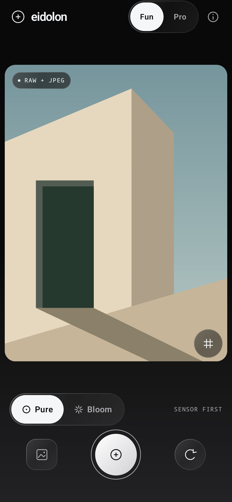
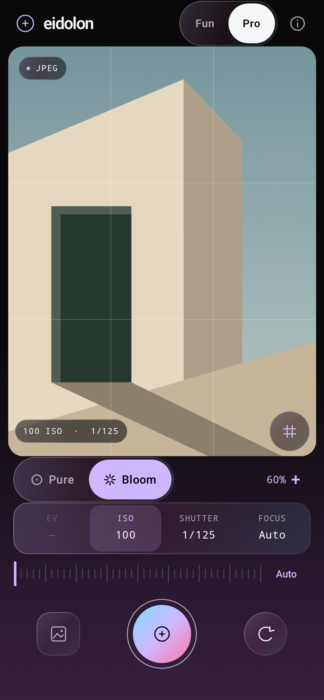
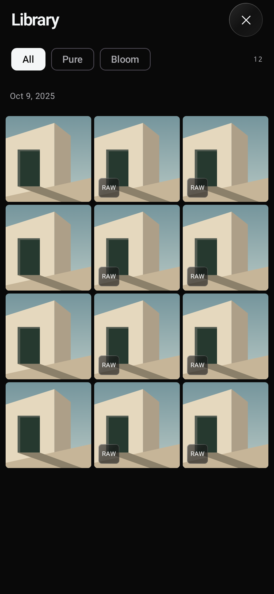
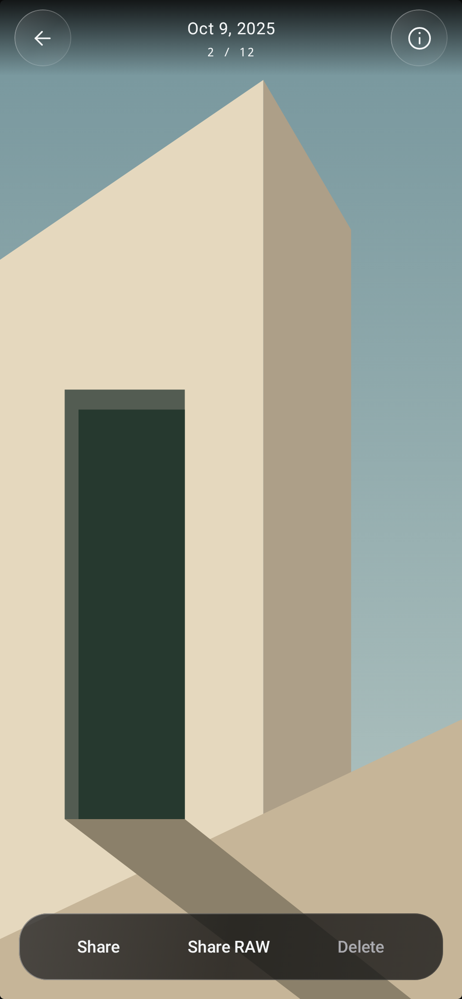
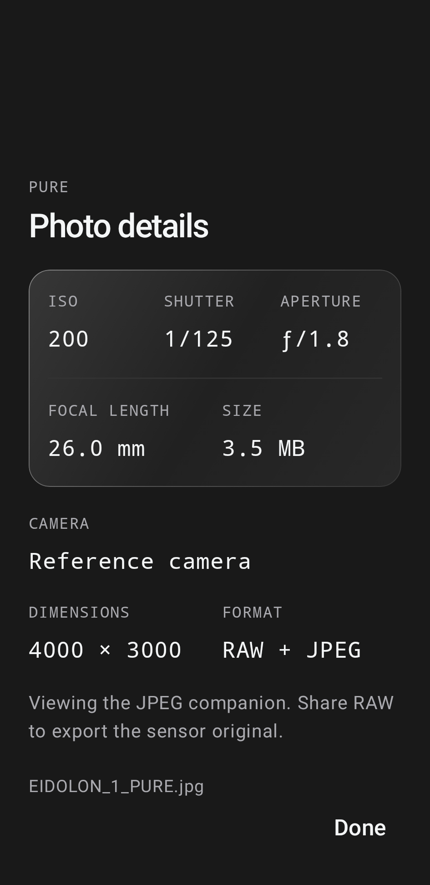

# Eidolon

**Your eye. Your reality.** An Android-first camera with two creative intentions and two levels of control.

- **Pure:** sensor RAW/DNG plus a companion JPEG where the camera supports it. Requests noise reduction and edge enhancement OFF when exposed by the device. Falls back visibly to JPEG when the RAW session is unavailable.
- **Bloom:** a warm, saturated rendering with gentler contrast and an adjustable intensity. A shared color matrix drives the preview and saved JPEG. This is the first color treatment, not a finished computational photography pipeline.
- **Fun:** automatic exposure and focus, a big shutter, composition grid, camera switching, and an integrated photo library.
- **Pro:** manual ISO and shutter speed, manual focus, exposure compensation in auto exposure, live metering, and control-specific Auto/Zero actions. Unsupported controls stay disabled.

Native Kotlin / Jetpack Compose UI; Camera2 capture; local MediaStore storage. Android 10+ (API 29). No account, analytics, network permission, location collection, or cloud processing.

## Download

Get **[v0.1.0-alpha.5 — Viewfinder](https://github.com/wckdboy/eidolon/releases/tag/v0.1.0-alpha.5)** from GitHub Releases. This is an early testing release, not a production camera recommendation.

| Asset | Purpose |
| --- | --- |
| `eidolon-0.1.0-alpha.5-release.apk` | Signed, non-debuggable universal APK; recommended for trying the app. |
| `eidolon-0.1.0-alpha.5-debug.apk` | Debuggable universal APK with a separate application ID; can coexist with the release app. |
| `README.md` | These setup instructions, features, and known limits. |
| `SHA256SUMS` | Download checksums. |
| `BUILD-INFO.txt` | Source commit, build versions, validation, and signing certificate fingerprint. |
| `mapping.txt.gz` | R8 mapping for decoding crash stack traces from this release. |
| `ui-previews.zip` | Thirteen host-rendered UI reference images using a synthetic scene. |

Download an APK on your Android phone, open it, and allow installation from your browser or file manager when Android asks. APKs support Android 10 and newer. The release app uses `studio.eidolon.camera`; the debug app uses `studio.eidolon.camera.debug`.

If you installed the earlier locally built debug APK under `studio.eidolon.camera`, uninstall that build before installing the signed release APK: their signatures differ. Photos already saved in Pictures/Eidolon remain in shared storage.

Both variants save into Pictures/Eidolon. iOS builds are not available yet.

## Run

Open this directory in Android Studio, use JDK 17+, and install Android SDK platform 37. The wrapper uses Gradle 9.8.1 with a pinned distribution checksum; the app uses AGP 9.4.1, Kotlin Compose plugin 2.4.21, Compose BOM 2026.09.00, and Activity Compose 1.13.0. Connect a phone with USB debugging enabled, or use an Android emulator.

```sh
./gradlew :app:assembleDebug :app:testDebugUnitTest :app:lintDebug
adb install -r app/build/outputs/apk/debug/app-debug.apk
```

Set `ANDROID_HOME` to your SDK directory, or create an untracked `local.properties` containing `sdk.dir=/path/to/Android/sdk`.

Grant camera access from the opening screen. Photos appear under **Pictures/Eidolon**. Pure produces a matched `.dng` / `.jpg` pair when available; Bloom produces a `.jpg`. The library button opens Eidolon’s built-in gallery. Browse captures grouped by date, filter Pure/Bloom shots, swipe between photos, double-tap or pinch to zoom, tap once to hide or reveal viewer controls, inspect the exposure metadata sheet, share the original JPEG or its RAW companion, and delete a capture after confirmation. The camera pauses while browsing and resumes when you return. The library shows Eidolon photos accessible to this installation; it does not request access to your whole photo library. Photos from another app variant or an uninstalled copy may only be accessible through your system gallery.

## Release builds

The maintainer's signing identity lives in the ignored `.signing/` directory. Keep an encrypted backup of that directory: future compatible release updates require the same signing key. Never upload it as a release asset or commit it.

For a new independent signing identity, run this once with JDK 17+ on PATH or `JAVA_HOME` set:

```sh
python3 scripts/create-signing-key.py
./gradlew :app:assembleDebug :app:assembleRelease :app:testDebugUnitTest :app:lintDebug :app:lintRelease
```

The script refuses to overwrite existing signing material. With `.signing/release.properties` present, `assembleRelease` generates a signed APK at `app/build/outputs/apk/release/app-release.apk`. Without local signing material, Gradle produces an unsigned release APK, which must be signed before distribution. The debug APK is under `app/build/outputs/apk/debug/app-debug.apk`. Release builds enable [R8 code and resource optimization](https://developer.android.com/topic/performance/app-optimization/enable-app-optimization); debug builds retain development tooling. Archive `app/build/outputs/mapping/release/mapping.txt` with each release to decode optimized stack traces.

## Capture architecture

`CaptureModel.kt` holds capture intent, capabilities, orientation math, and Bloom rendering coefficients. `CameraEngine.kt` confines Camera2 lifecycle and frame matching to a camera thread. Capture results, RAW images, and JPEGs must have matching, non-null sensor timestamps before saving. Capture settings are frozen for each shot; one camera acquisition is in flight, while a single writer drains a bounded queue. Normal-memory devices can hold two captures including the active save; low-memory devices allow one. The shutter unlocks after the camera delivers its frames when queue capacity remains, without waiting for disk writes or Bloom encoding. Failed writes remove their MediaStore entries. Reader leases keep in-flight RAW images valid while the camera shuts down; readers close after the save releases its image.

`PhotoStore.kt` writes DNG/JPEG pairs through pending MediaStore entries. DNG encoding and Bloom rendering run on a single background-priority worker so image encoding does not compete at foreground priority with the camera UI. DNGs write directly into MediaStore without a temporary DNG file and second copy. Bloom encodes directly into a pending MediaStore file. EXIF is prepared using a tiny temporary JPEG, then its APP1 segment is inserted as the full-resolution JPEG is encoded. This removes the previous full-file EXIF rewrite without changing quality 97 or capture resolution. Exposure, orientation, and actual pixel dimensions are retained; the temporary metadata file is removed. The source bitmap is released before encoding. Bloom skips rendering and recompression entirely at 0%. Zero-strength Bloom also bypasses the preview color-filter layer. The UI gets immutable capability and metering snapshots. Capture and composition state are separate from Android storage and presentation, providing a starting point for a later native iOS implementation.

## Current UI and responsiveness improvements

Alpha.5 gives more space to the image in Pro: RAW/JPEG status, metering, and the grid toggle sit at the viewfinder edges, while a compact glass control strip replaces the separate Pro cards. The full capture aspect ratio stays visible. Pure retains monochrome glass controls; entering Bloom shifts into vivid violet/pink/cyan. Translucent surfaces, fine highlights, pill selectors, and a tactile shutter keep the image central. Glass is drawn with lightweight gradients and borders; it does not blur or copy camera frames. Permission, opening, saving, error, and capture-information states share the same visual system. The adaptive launcher icon supports themed icons. Small dark glass surfaces keep the corner controls legible while leaving the rest of the live image unobscured.

Tap a Pro control for a tick-marked adjustment ruler with haptic detents; tap Bloom’s percentage for intensity. The grid has a 48 dp toggle target and checked-state semantics. Sliders announce actual ISO, shutter, focus, and EV values; exposure compensation snaps to hardware-supported increments. Fractional shutter times display accurately (for example, 0.80s), and reciprocals round correctly. Larger text gets simplified selectors. Auto restores the selected focus or exposure controls without resetting unrelated settings; Zero resets EV.

Pure/Bloom, intensity, Fun/Pro, and the grid persist across launches. Preferences load off the UI thread, slider changes are debounced before asynchronous disk writes, and unchanged preferences are skipped. Manual sensor settings start in Auto on a cold launch; switching to Fun also resets manual exposure, focus, and EV. The last photo remains available across launches.

The gallery reads metadata off the UI thread, caches at most 16 MiB of thumbnails, and limits concurrent reads to two. Only the active viewer page loads an image up to 3,072 pixels on its longest edge; other pages use thumbnails. Zoom affects this display copy, while sharing uses the untouched full-resolution file. A RAW/JPEG pair appears as one moment; deleting it removes both files. Pending saves appear automatically after publication. Date groups, filtering, and the gallery scroll position are retained while viewing a photo. Deleting the newest photo updates the camera’s thumbnail to the next available image. Viewer controls fade over the image and can be hidden with a tap. The metadata sheet separates ISO, shutter, aperture, focal length, camera, dimensions, size, and RAW/JPEG status; missing camera metadata stays explicitly unrecorded.

The presentation is separated from camera ownership. Short color and shutter-press transitions use 90–240 ms animations; no decorative blur or continuous animation is applied to the viewfinder. Bloom intensity changes update only its rendering layer. Sensor updates are coalesced over 16 ms, identical camera snapshots are skipped, and completed capture timeouts are cancelled. R8 remains enabled for release code and resources. These changes remove avoidable work; initial OnePlus processing measurements are recorded below, while controlled latency and peak-memory benchmarks remain to be collected.

The following are host-rendered previews of the actual Compose UI, using a synthetic architectural scene. They demonstrate layout, not photographic output.

<p>
  
  
  
  
  
</p>

### Mobbin references

These references were retrieved and visually inspected through the Mobbin MCP for this release. Eidolon adapts the interaction hierarchy to its own Pure/Bloom identity.

| Reference | Applied to Eidolon |
| --- | --- |
| [Halide Mark III camera](https://mobbin.com/screens/5b0f05a2-1061-4630-af99-abdf73608a49) | Status at the viewfinder edges and a compact manual-control area close to the shutter. |
| [Halide Mark III photo metadata](https://mobbin.com/screens/c2b0a38f-51af-4545-9ca4-332aae5688e3) | Structured exposure and file details in a bottom sheet over the photo. |
| [(Not Boring) Camera adjustments](https://mobbin.com/screens/4b1b9fbe-07b0-436e-b562-43115ea049aa) | Visible ruler ticks, a precise adjustment indicator, and tactile feedback. |
| [VSCO photo grid](https://mobbin.com/screens/e53589a9-e5c8-4aab-831e-1064e4076f63) | Dense image-led browsing with compact filters; Eidolon also groups captures by date. |

## Honest limits of this first build

- RAW is hardware-dependent. A DNG is sensor data exposed by the manufacturer, not a guarantee that every internal correction is absent. Pure’s companion JPEG and viewfinder still go through the phone’s rendering pipeline. See Android’s [RAW/DNG API](https://developer.android.com/reference/android/hardware/camera2/DngCreator) and [processing controls](https://developer.android.com/reference/android/hardware/camera2/CaptureRequest).
- Bloom currently grades an 8-bit camera JPEG. It does not yet develop the DNG, merge exposures, recover clipped highlights, apply local tone mapping, or synthesize scene detail. Preview and capture can differ because the device renders those streams separately.
- JPEG capture prefers 4:3 at up to 12.5 MP to bound memory use; if every available size exceeds that, the smallest supported size is used. RAW uses the largest exposed sensor size. Shutter time is capped at one second in this build.
- The UI is designed for portrait phones. Host-rendered layouts cover 320–390 dp widths and 1.5× text; tablet, foldable, landscape, and more extreme accessibility configurations need further work.
- No tap-to-meter, lens zoom selector, burst, flash controls, histogram, focus peaking, manual white balance, editing tools, or background capture yet.
- Camera characteristics are capability claims; real phone testing must verify output, focus, framing, color, latency, thermal behavior, and repeated capture stability. Emulator tests cannot establish real sensor quality.
- iOS is not implemented. A later AVFoundation capture engine should preserve the same Pure/Bloom intent and Fun/Pro control split while checking capabilities independently.

## Next imaging milestone

Start with one reference Android phone and a fixed collection of daylight, skin, foliage, neon, backlit, and low-light scenes. Measure capture latency and inspect its DNGs before tuning Pure. Evolve Bloom toward a deliberate scene-referred rendering: controlled highlight roll-off, natural skin color, selective local contrast, and subtle bloom, always keeping the original. Benchmark each step on the actual device before adding it to the shutter path.

## Validation

The debug build, twelve unit tests (color, orientation, shutter labels, timestamp matching, sensor-control changes, concurrent reader ownership, and streaming JPEG metadata), and Android lint are runnable with the command above. Twelve Android instrumentation tests cover original-byte preservation, zero-strength Bloom, graded JPEG metadata, RAW-write and Bloom-decode rollback, saving while the camera closes, repeated captures with rapid adjustments and lens switching, preference recovery, and UI interaction/persistence. The UI test checks that changing modes keeps the same preview view attached. Additional tests block the writer to verify queue backpressure, exercise gallery/viewer/details/delete/return navigation, retained filtering and thumbnail refresh, hide/reveal controls, and save three 12 MP Bloom images to verify dimensions, orientation, thumbnail caching, and bounded viewer decoding. The stress test takes eight alternating Pure/Bloom shots after 800 rapid adjustments and three lens switches, checking every JPEG and saved-file count; its logged timings include test synchronization and must be reported with the device and build variant. Run them on a connected emulator or phone with `./gradlew :app:connectedDebugAndroidTest`. When multiple devices are connected, set `ANDROID_SERIAL` to the intended test device so other devices are left untouched. The optimized release has a separate startup/preview lifecycle smoke test: `./gradlew -PtestBuildType=release :app:connectedReleaseAndroidTest`. Before running it, build and install the release APK, then grant camera permission with `adb -s DEVICE_SERIAL shell pm grant studio.eidolon.camera android.permission.CAMERA`. If the device blocks shell permission grants, open the app and allow Camera while using it instead. Debug camera tests likewise respect existing permission: install the debug APK and grant Camera in that app before running them on such devices. This keeps the framework-only smoke test independent of UI automation services. It requires local release signing material and logs startup/recreation/reopen-to-moving-preview times plus process PSS under `EidolonPerformance`; these are device diagnostics, not universal speed claims. Lint currently emits non-blocking warnings, including the portrait layout and platform EXIF API. Hardware acceptance testing remains required before a production release.

In alpha.1, on an API 36.1 emulator, the permission flow, live preview, camera switching, background/resume recovery, Pure DNG + JPEG capture, and Bloom JPEG capture were exercised. Both JPEGs decoded successfully with orientation preserved. The DNG contained a CFA photometric tag and DNG version metadata. A Pro capture requested ISO 469 and the saved JPEG reported ISO 469. No runtime crashes were logged during these checks. Synthetic emulator scenes were used; these checks do not establish photographic quality.

Alpha.1 interface captures (the current layout has changed): [Pure / Fun](https://github.com/wckdboy/eidolon/blob/main/artifacts/screenshots/pure.png) and [Bloom / Pro](https://github.com/wckdboy/eidolon/blob/main/artifacts/screenshots/bloom-pro.png).

Alpha.2 passed all eight unit tests and five instrumentation tests on a fresh API 36.1 emulator. The capture integration test saved a DNG/JPEG pair while closing the camera, decoded the JPEG, checked DNG dimensions, reopened the camera, and saved a Bloom JPEG. A separate smoke test against the optimized release APK verified changing camera frames after startup, activity recreation, and closing/reopening the app. All 14 checks (eight unit tests, five debug instrumentation tests, and one release smoke test) passed. Both build variants and lint checks completed successfully.

Alpha.3 passed all nine unit tests, nine debug instrumentation tests, the optimized-release lifecycle test, and eight screenshot regression cases. Both APK variants built successfully; debug and release lint report zero errors and 13 non-blocking warnings. The signed release APK is about 1.94 MB.

Alpha.4 passed twelve unit tests, twelve debug instrumentation tests, the optimized-release lifecycle test, and eleven screenshot regression cases. Both APK variants build successfully; debug and release lint report zero errors and 22 non-blocking warnings. The new checks verify that a second capture can complete while the writer is deliberately blocked, reject captures at queue capacity, and exercise gallery swipe, double-tap zoom, metadata, deletion confirmation, and return to the camera. Three synthetic 12 MP Bloom files retained full dimensions and orientation; their display copies decoded within the 3,072-pixel viewer bound. Real-phone processing speed remains unmeasured; this release removes a JPEG rewrite and reduces shutter lockout without reducing saved-image resolution or encoding quality.

Alpha.5 passed twelve unit tests, twelve debug instrumentation tests, the optimized-release lifecycle test, and thirteen screenshot cases. Debug and release lint report zero errors and 23 non-blocking warnings. The gallery interaction test additionally checks hiding/revealing controls, the metadata sheet, retained filtering, and refreshing the camera thumbnail after deletion. Camera mode changes still retain the same preview view. Haptic feel and real-phone frame pacing remain hardware acceptance checks.

The thirteen host-rendered screenshot cases cover: Pure Fun, Bloom Pro, a small phone, Pure and Bloom at 1.5× text, permission, error, saving, gallery, empty gallery at large text, photo viewer, hidden viewer controls, and the metadata panel at larger text. Reference images are committed under `app/src/screenshotTestDebug/reference`. Run `./gradlew :app:validateDebugScreenshotTest` to check them; after an intentional UI change, render with `:app:updateDebugScreenshotTest` and inspect the new images before accepting them. The screenshot plugin is experimental and is used only for development tests.

One alpha.3 API 36.1 emulator smoke run measured instrumented activity launch → moving preview at 1,079 ms, recreation at 450 ms, and reopening at 1,052 ms, with process PSS samples of 36,850–38,409 KiB. These include test synchronization and run inside an already started instrumentation process; they are neither process cold-start benchmarks nor peak capture-memory measurements. These historical emulator numbers do not measure phone latency, color, thermal behavior, or peak memory.

Initial OnePlus 15 (CPH2747, Android 16) validation on 2026-10-16: the alpha.5 signed release passed the moving-preview startup, activity-recreation, and reopen smoke test. All twelve debug checks passed across the hardware run and a focused UI rerun, including real RAW/JPEG capture, saving through camera closure, queue limits, gallery/viewer interaction, and metadata/rollback. The UI persistence check initially checked a frame control before camera readiness; after synchronizing on readiness, it passed on both the phone and emulator.

The eight-shot debug stress run (100 rapid settings updates before each shot, alternating Pure/Bloom, with three camera switches) measured 445, 618, 583, and 684 ms for Pure and 1,022, 1,195, 994, and 1,144 ms for Bloom, from adjustments through saved output. Writer-stage times were 123–215 ms for Pure including DNG and 227–411 ms for Bloom; these are not shutter-release or isolated sensor-latency measurements. Three synthetic 4000×3000 Bloom saves took 216, 253, and 246 ms in the initial run and 98, 114, and 109 ms in the later run, excluding camera acquisition. The substantial variation and debug instrumentation mean these are initial diagnostics, not controlled release benchmarks or image-quality claims.

OxygenOS rejected automated permission grants on this phone. Tests now respect permission granted manually. For repeat phone testing, build the debug and test APKs with `./gradlew :app:assembleDebug :app:assembleDebugAndroidTest`, install both with `adb -s DEVICE_SERIAL install -r APK_PATH`, open the debug app and allow Camera, then run `adb -s DEVICE_SERIAL shell am instrument -w studio.eidolon.camera.debug.test/androidx.test.runner.AndroidJUnitRunner`. This direct runner leaves the app installed and preserves its grant; Gradle connected-test cleanup can remove the test app and its permission.
